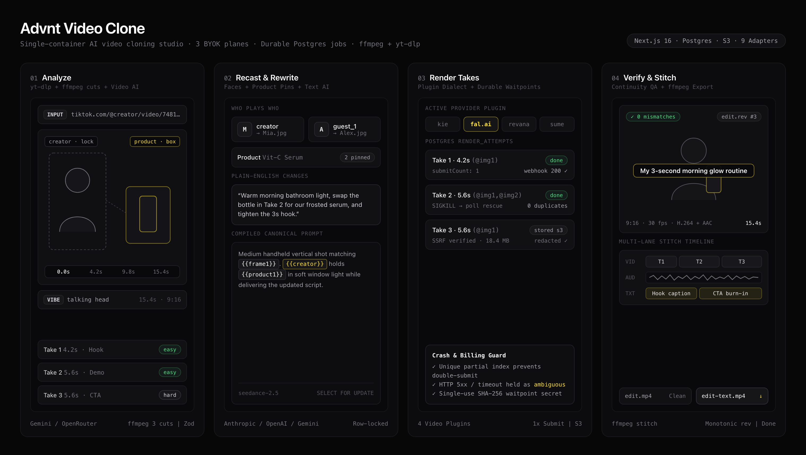
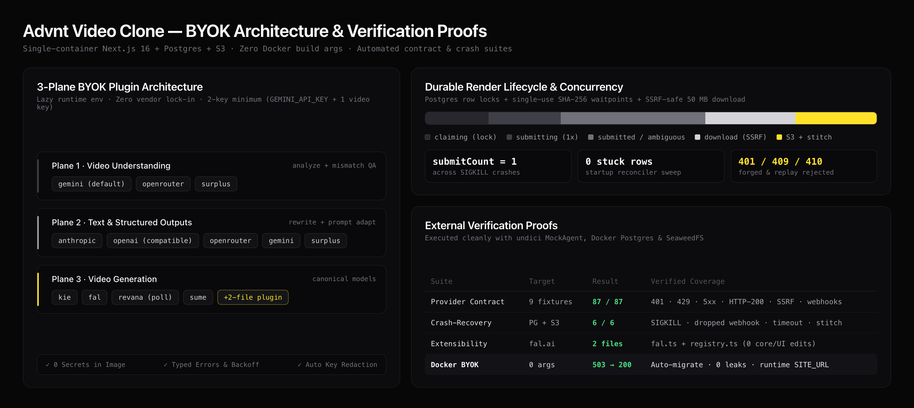

# Advnt Video Clone

[](https://github.com/arthuryeti/advnt-clone-tool)
[](https://nextjs.org/)
[](docker-compose.yml)
[](#bring-your-own-keys-byok)
[](#architecture--verification)
[](LICENSE)

**Self-hostable, BYOK AI video cloning studio in a single container.** Paste a TikTok or Instagram URL (or upload an MP4) to split a reference video into timed shots and takes, recast who plays who with your own faces and product photos, rewrite the script or visual look in plain English, render takes across pluggable AI video generators, and export a stitched vertical cut.

Built on **Next.js 16 + tRPC + Drizzle/Postgres + S3 + `ffmpeg` + `yt-dlp`** with zero external queue infrastructure — hardened with Postgres-backed crash reconciliation, single-use authenticated waitpoints, SSRF-checked downloads, secret redaction, and auto-migrating container boots.



---

## Why This Exists

Cloning short-form video pipelines from scratch breaks in predictable ways: rigid vendor lock-in (one gateway or model slug baked into prompts), in-memory job state that strands paid renders or double-bills on server restarts, unauthenticated webhooks, and brittle multi-service setups.

**Advnt Video Clone** turns the entire workflow into a durable, self-contained single-instance app across four stages:

1. **Analyze (`trigger/analyze-video-clone.ts`):** Downloads social links via `yt-dlp` (with process timeouts) or uploaded clips from S3, detects scene cuts with `ffmpeg`/`ffprobe`, and invokes your configured Video Understanding plugin (`lib/ai/describe-video.ts`) to produce a structured shot-by-shot Zod plan in Postgres (`content_templates`).
2. **Recast & Rewrite (`components/organization/video-clone-detail.tsx`, `trigger/rewrite-video-clone.ts`):** Swap characters with uploaded faces ("Who plays who"), pin product reference images, edit spoken dialogue, pick canonical models (`seedance-2.5`, `wan-3.0`), or rewrite the whole plan in plain English via your Text plugin (`lib/ai/adapt-video-clone-prompts.ts`) under `SELECT ... FOR UPDATE` row locks.
3. **Render (`trigger/generate-video-clone.ts`, `lib/render-reconciler.ts`):** Persists each take/shot attempt in Postgres (`render_attempts` + `job_waitpoints`) before sending a billable API call — rescuing mid-render restarts (`SIGKILL`), holding socket-timeout `ambiguous` submits without duplicate billing, rejecting forged/replayed webhooks, and downloading completed clips through SSRF-safe streaming limits (`50 MB`).
4. **Verify & Stitch (`lib/content-workflows/check-render.ts`, `trigger/stitch-video-clone.ts`):** Optionally vets rendered takes for shot/action mismatches against the reference plan, extracts continuity frames (`{{frameN}}`) for multi-take consistency, stitches takes/shots in story order with `ffmpeg`, and commits results atomically using monotonic `edit.revision` checks.

---

## Architecture & Verification



### External Verification Proofs

Every claim below is backed by tests in this repository (`npm test`, `npm run test:integration`, and Docker clean-room runs):

| Suite / Proof | Target | Result | Verified Guarantees |
| :--- | :---: | :---: | :--- |
| **Provider Contract Suite** | 9 raw fixtures | **87 / 87** | Happy paths, malformed payloads, HTTP-200 error codes, 401 fail-fast, 429 `Retry-After`, 5xx jitter backoff, submit-timeout `ambiguous_submit` non-retry, webhook auth/replay/mismatch, SSRF/redirect stripping, secret redaction |
| **Crash-Recovery & Fault Suite** | Docker PG + S3 | **6 / 6** | Mid-render `SIGKILL` + dropped webhook recovery (`submitCount === 1`), real `ffmpeg` stitch to SeaweedFS, forged (`401`) & replayed (`409`) webhook rejection, socket-drop rescue & expiry cleanup, concurrent render lock, zero canary key leaks across logs/DB/tRPC |
| **Extensibility Proof** | `fal.ai` | **2 files** | Added [`lib/ai/providers/video/fal.ts`](lib/ai/providers/video/fal.ts) + 2 lines in [`registry.ts`](lib/ai/providers/video/registry.ts) (0 edits to `trigger/`, `trpc/`, `components/`, `lib/env.ts`, `lib/preflight.ts`, or UI) — automatically passed the full Shared Provider Contract Suite |
| **Prebuilt Docker BYOK Check** | Zero build args | **503 → 200** | Single prebuilt image booted cleanly without `SURPLUS_API_KEY`: failed fast (`503`) on bad `GEMINI_API_KEY` with 0 leaks, then passed (`200 ok: true`, all 8 checks) after swapping valid keys + `SITE_URL` at runtime |

### Hardening & Reliability Summary

| Hazard | Hardened Mechanism | Primary Implementation |
| :--- | :--- | :--- |
| **Duplicate billable submits** | Partial unique index `render_attempts_active_target_uidx`, `idempotency_key`, and `isBillableSubmit: true` non-retry policy | [`lib/db/schema.ts`](lib/db/schema.ts), [`lib/ai/http.ts`](lib/ai/http.ts) |
| **Crashes & dropped webhooks** | Startup + periodic reconciler (`reconcileInFlightWork`), worker heartbeats, and `ambiguous` webhook rescue / expiry sweep | [`lib/render-reconciler.ts`](lib/render-reconciler.ts), [`instrumentation.ts`](instrumentation.ts) |
| **Forged / replayed callbacks** | UUID check, 1 MiB body limit, SHA-256 timing-safe secret match, job ID check, and atomic single-use consume (`401`/`409`/`410`) | [`app/api/waitpoints/[id]/route.ts`](app/api/waitpoints/%5Bid%5D/route.ts), [`lib/jobs.ts`](lib/jobs.ts) |
| **Artifact download SSRF** | IPv4/IPv6/IPv4-mapped/NAT64/IMDS & DNS-rebind blocking, manual redirect checks (max 5 hops), cross-origin auth stripping | [`lib/security/ssrf.ts`](lib/security/ssrf.ts), [`lib/storage/download-video.ts`](lib/storage/download-video.ts) |
| **Secret leaks in logs/DB/API** | Dynamic env secret scanner + pattern redaction (`Bearer`, `x-api-key`, `x-goog-api-key`, URL tokens) across logs, DB columns, tRPC | [`lib/security/redact.ts`](lib/security/redact.ts), [`trpc/init.ts`](trpc/init.ts) |
| **Concurrent template races** | Row-locked mutations (`SELECT ... FOR UPDATE`), `pg_advisory_xact_lock`, coalesced stitch queue, monotonic `edit.revision` | [`lib/content-workflows/video-clone-store.ts`](lib/content-workflows/video-clone-store.ts) |

---

## Quickstart

### 1. Let Your AI Agent Set It Up & Deploy

Open this repo in Claude Code, Codex, Cursor, or Antigravity and paste:

```text
Read AGENTS.md and DEPLOY.md, then help me configure my BYOK API keys, verify `npm run doctor` / `/api/preflight`, and deploy or launch this Video Clone instance.
```

[`AGENTS.md`](AGENTS.md) and [`DEPLOY.md`](DEPLOY.md) contain the interactive checklist, platform manifests (`railway.json`, `render.yaml`, `deploy/fly.toml`, `deploy/docker-compose.vps.yml`), and failure diagnostics.

### 2. One-Command Docker Stack (Zero Host Dependencies)

Minimum setup requires **2 keys**: `GEMINI_API_KEY` (covers both video analysis and text rewriting) + 1 video generation key (`FAL_API_KEY`, `KIE_API_KEY`, `REVANA_API_KEY`, or `SUME_API_KEY`).

```bash
cp .env.example .env
# Add GEMINI_API_KEY + your video provider key in .env

docker compose --profile full up -d --build
```

The production entrypoint (`scripts/docker-entrypoint.mjs` → `scripts/migrate.mjs`) waits for Postgres, applies pending Drizzle migrations under an advisory lock, boots Next.js on **http://localhost:3000**, and exposes readiness at **http://localhost:3000/api/preflight**.

> **Port already in use?** Override host ports without touching config files:
> ```bash
> POSTGRES_PORT=5434 S3_PORT=8334 APP_PORT=3001 docker compose --profile full up -d --build
> ```

### 3. Local Development

Requires **Node 24+**, **Docker**, **`ffmpeg`/`ffprobe`**, and **`yt-dlp`** (`brew install ffmpeg yt-dlp` on macOS):

```bash
cp .env.example .env            # add your BYOK API keys
docker compose up -d            # Postgres :5433 + SeaweedFS S3 :8333 (use POSTGRES_PORT=5434 if busy)
npm install
npm run db:migrate              # apply Drizzle schema migrations
npm run doctor                  # non-billable preflight check
npm run dev                     # http://localhost:3000
```

> **Local webhook vs polling tip:**
> - **Polling-only local runs:** Set `VIDEO_PROVIDER=revana` with `REVANA_API_KEY` — no public tunnel required.
> - **Webhook providers (`kie`, `fal`, `sume`):** Providers POST finished renders to `<SITE_URL>/api/waitpoints/<id>` and fetch signed reference images from `S3_PUBLIC_ENDPOINT`. Expose local port `3000` with `cloudflared tunnel --url http://localhost:3000` (set `SITE_URL` to the tunnel URL) and point `S3_*` at R2/S3 or a tunneled endpoint.

### 4. Preflight / Doctor Check

Before running any billable job, verify database connectivity, local binaries, S3 reachability, callback health, and API credentials with zero spend:

```bash
npm run doctor
# Or hit GET http://localhost:3000/api/preflight
```

<details>
<summary>Example <code>GET /api/preflight</code> JSON response (HTTP 200)</summary>

```json
{
  "ok": true,
  "checkedAt": "2026-11-27T11:36:40.747Z",
  "scope": "all",
  "checks": [
    { "name": "database", "ok": true, "details": "Postgres reachable" },
    { "name": "binaries", "ok": true, "details": "ffmpeg, ffprobe, and yt-dlp available" },
    { "name": "storage_s3", "ok": true, "details": "S3 bucket \"clone-media\" accessible" },
    { "name": "video_generation_provider", "ok": true, "details": "KIE credentials verified" },
    { "name": "s3_public_reachability", "ok": true, "details": "Signed S3 URL reachable (http://s3:8333)" },
    { "name": "callback_url", "ok": true, "details": "Waitpoint callback reachable at http://localhost:3000" },
    { "name": "video_analysis_provider", "ok": true, "details": "Gemini (gemini-2.5-flash) verified" },
    { "name": "text_provider", "ok": true, "details": "Anthropic (claude-sonnet-4-5) verified" }
  ]
}
```

</details>

---

## Bring Your Own Keys (BYOK)

Every secret, model override, storage endpoint, and `SITE_URL` is read lazily from `process.env` at request/job time (`lib/env.ts`). Changing keys or swapping providers in Docker requires only restarting the container with updated environment variables — **never rebuilding the image**. Unused providers never crash startup.

### Plane 1 — Video Understanding (`analyze` & render mismatch checks)

Auto-selects the first configured key below when `VIDEO_ANALYSIS_PROVIDER` is unset:

| Provider ID | API Key Env Var | Default Model (`VIDEO_ANALYSIS_MODEL`) | Optional Base URL Override |
| :--- | :--- | :--- | :--- |
| **`gemini`** | `GEMINI_API_KEY` | `gemini-2.5-flash` | `GEMINI_BASE_URL` |
| **`openrouter`** | `OPENROUTER_API_KEY` | `google/gemini-2.5-flash` | `OPENROUTER_BASE_URL` |
| **`surplus`** | `SURPLUS_API_KEY` | `gemini-3.8-flash` | `SURPLUS_BASE_URL` |

### Plane 2 — Text & Structured Outputs (`rewrite` & prompt adaptation)

Auto-selects the first configured key below when `TEXT_PROVIDER` is unset (`GEMINI_API_KEY` powers both Plane 1 and Plane 2 automatically):

| Provider ID | API Key Env Var | Default Model (`TEXT_MODEL`) | Optional Base URL Override |
| :--- | :--- | :--- | :--- |
| **`anthropic`** | `ANTHROPIC_API_KEY` | `claude-sonnet-4-5` | `ANTHROPIC_BASE_URL` |
| **`openai`** | `OPENAI_API_KEY` | `gpt-4.1` | `OPENAI_BASE_URL` (any OpenAI-compatible API) |
| **`openrouter`** | `OPENROUTER_API_KEY` | `anthropic/claude-sonnet-4.5` | `OPENROUTER_BASE_URL` |
| **`gemini`** | `GEMINI_API_KEY` | `gemini-2.5-flash` | `GEMINI_BASE_URL` |
| **`surplus`** | `SURPLUS_API_KEY` | `claude-opus-5.5` | `SURPLUS_BASE_URL` |

### Plane 3 — Video Generation (`render`)

Selected via `VIDEO_PROVIDER` (default `kie`). Stored clone plans keep canonical model IDs (`seedance-2.5`, `wan-3.0`); each adapter translates image reference tokens, duration bounds, pricing, and wire envelopes locally:

| Provider ID | API Key Env Var | Delivery Mechanics | Public Callback? | Models & Image Token Dialects |
| :--- | :--- | :--- | :---: | :--- |
| **`kie`** | `KIE_API_KEY` | Webhook + Poll | Yes (`SITE_URL`) | `seedance-2.5` (`@imageN`), `wan-3.0` (`ImageN`) |
| **`fal`** | `FAL_API_KEY` | Webhook + Two-step Poll | Yes (`SITE_URL`) | `seedance-2.5` (`@imgN`), `wan-3.0` (`ImageN`) |
| **`revana`** | `REVANA_API_KEY` | Poll + `Idempotency-Key` | **No** | `seedance-2.5` (`@imageN`), `wan-3.0` (`ImageN`) |
| **`sume`** | `SUME_API_KEY` | Webhook + Poll + `Idempotency-Key` | Yes (`SITE_URL`) | `seedance-2.5` (`@imageN`), `wan-3.0` (`ImageN`) |

---

## Plugging In a New AI Provider

To add a new video vendor `<id>` (following [`lib/ai/providers/video/fal.ts`](lib/ai/providers/video/fal.ts)):

1. Add sanitized HTTP wire payloads to `lib/ai/fixtures/<id>.json` (`submit`, `poll`, `webhook`, `preflight`, and typed error responses).
2. Implement `VideoGenerationProvider` ([`lib/ai/providers/video/types.ts`](lib/ai/providers/video/types.ts)) in `lib/ai/providers/video/<id>.ts` using `fetchJsonWithTimeout` (`isBillableSubmit: true` on `submit`, `withBackoffRetry` on idempotent `getStatus`), Zod validation, and `downloadVideo`.
3. Register the adapter in [`lib/ai/providers/video/registry.ts`](lib/ai/providers/video/registry.ts) (1 import + 1 array entry). Zero edits to `trigger/`, `trpc/`, `components/`, `lib/env.ts`, or `lib/preflight.ts`.

Run `npm test` — [`provider-contract.test.ts`](lib/ai/providers/provider-contract.test.ts) automatically discovers your registered plugin and verifies every HTTP, retry, webhook, SSRF, and redaction invariant against your fixture. See [CONTRIBUTING.md](CONTRIBUTING.md) for Text and Video Understanding adapter instructions.

---

## Deploy Anywhere

Full production instructions (including Cloudflare R2 / AWS S3 CORS configuration and reverse-proxy auth) live in **[DEPLOY.md](DEPLOY.md)**. Ready-to-deploy templates included:

| Target | Configuration File | Highlights |
| :--- | :--- | :--- |
| **Railway** | [`railway.json`](railway.json) | Dockerfile build, single replica, `/api/waitpoints/health` healthcheck |
| **Render** | [`render.yaml`](render.yaml) | Blueprint with Managed Postgres + `numInstances: 1` Docker web service |
| **Fly.io** | [`deploy/fly.toml`](deploy/fly.toml) | `min_machines_running = 1`, `auto_stop_machines = "off"`, `2gb` RAM for `ffmpeg` |
| **VPS / Coolify / Dokploy** | [`deploy/docker-compose.vps.yml`](deploy/docker-compose.vps.yml) | App + Postgres + Caddy auto-HTTPS (`deploy/Caddyfile`) + optional Basic Auth |
| **Local Full Docker** | [`docker-compose.yml`](docker-compose.yml) | Postgres + SeaweedFS S3 + auto-migrating App container under `--profile full` |

---

## Limitations & Security Notes

- **Single long-lived container only:** Background tasks (`analyze`, `rewrite`, `render`, `stitch`), `ffmpeg`, and `yt-dlp` run inside one Node process ([`lib/jobs.ts`](lib/jobs.ts)) with Postgres restart reconciliation. Do **not** deploy to serverless functions or scale horizontally past `1` replica.
- **No built-in user login:** Every row uses the single-tenant `WORKSPACE_ID` ([`lib/db/index.ts`](lib/db/index.ts)). Put any internet-facing deployment behind Caddy Basic Auth ([`deploy/Caddyfile`](deploy/Caddyfile)), Cloudflare Access, or Tailscale while keeping `/api/waitpoints/*` unauthenticated so video providers can deliver token-verified webhooks.
- **Public storage & callback requirements:** Webhook providers (`kie`, `fal`, `sume`) require a publicly reachable HTTPS `SITE_URL` and CORS-enabled `S3_PUBLIC_ENDPOINT`. In local Docker (`docker-compose.yml`), `PREFLIGHT_ALLOW_LOCAL_URLS=true` lets `/api/preflight` pass against local `s3:8333` for smoke tests; use `VIDEO_PROVIDER=revana` or a tunnel for live renders.

---

## Checks & Tests

```bash
npm run typecheck          # TypeScript strict check (tsc --noEmit)
npm run check              # Biome lint & format check (0 errors, 0 warnings)
npm test                   # Unit tests + Shared Provider Contract Suite (87 tests)
npm run test:integration   # Postgres + SeaweedFS + ffmpeg crash-recovery & fault suite (6 tests)
npm run build              # Production Next.js standalone build
```

## License

Released under the **[MIT License](LICENSE)**.
